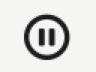
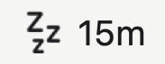
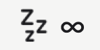
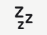
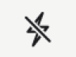
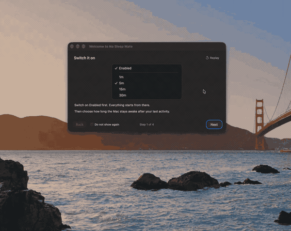
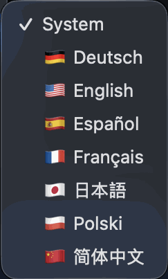

# No Sleep Mate

No Sleep Mate keeps your Mac awake while you need it, then locks the screen when you are done.
It lives in the menu bar, uses the power management features macOS already has, and stays out of the way. Nothing is simulated, and no permission is needed. No data collecting.

## Download and install

1. Open the [Releases page](https://github.com/Hardevv/No-sleep-mate/releases) and download the latest version.
2. Move No Sleep Mate to your Applications folder.
3. Open it. There is no Dock icon, so look for the app in the menu bar.

macOS 13 Ventura or later is required, on Apple Silicon or Intel.

This version is not notarized yet. If macOS blocks the first launch, open
System Settings > Privacy & Security and choose Open Anyway. This is needed only once.
Later versions will be signed with a Developer ID.

## What it does

- Keeps the Mac awake with power assertions, not by faking activity. A No AFK mode, which can simulate activity, is planned for a later version.
- Counts down the time you choose, then locks the screen. The Mac keeps working behind it.
- Has no Dock icon and no background window.
- Works offline and collects nothing.
- Works in continuity mode: set it once and it keeps running, unlike apps such as Amphetamine, where you start a session every time.

## The menu bar

Click the menu bar icon to turn the app on or off, choose how long to stay awake, and manage
presets.

| Menu bar                                                                          | Meaning                                               |
| --------------------------------------------------------------------------------- | ----------------------------------------------------- |
|             | Off, nothing is held awake                            |
|  | On, with the time left before the screen locks        |
|      | On, with no time limit                                |
|           | On, but the time is up, the hold released and the screen locked |
|        | On, but on battery while Only on Power Adapter is set |

The last minute is shown in seconds. The timer restarts whenever you use the Mac and begins
counting down after 10 seconds without activity, so it does not flicker while you type.

## Time limits

A preset is a number of minutes by default. You can also use units and mix them: `15`, `1h`,
`90m`, or `1h30m`. Limits are whole minutes, from 1 minute to 24 hours.

When the countdown reaches zero the screen locks at that moment, and the Mac carries on behind
it: a download keeps downloading, a render keeps rendering. Getting back in takes your password
or Touch ID, the same as any lock. To hold the Mac awake with no lock at the end, choose
**Never**.

The lock is a call macOS makes for itself rather than one of its public interfaces, so a future
macOS could take it away. If that happens the countdown still ends on time and the Mac stays
awake, and the menu says so in an orange line instead of locking silently or not at all.

**Never** is a mode, not a duration. The Mac stays awake until you change the mode.

## Options

- **Only on Power Adapter** holds the Mac awake only while it is plugged in. Unplugging lets
  it sleep as usual.
- **Pause while media plays** is on by default. Audio or video pauses the countdown, and the
  countdown resumes when playback ends, so a film is never cut short.
- **Sound warning** is off by default. Pick how early to be warned and which system sound to
  play, and it will play once before the time runs out.
- **Launch at Login** starts the app with your Mac. Keep the app in Applications.

## The tour and help

A short tour explains the menu bar and the main options. Tick `Do not show again` in its
footer to skip it next time. To see it again, choose `Help` > `Show the tour again` from the
menu.

Something wrong, or something missing? `Feedback / Report a Bug`, the row directly under
`Help`, opens the feedback page in the app's own window; the button at the bottom hands it to
your browser if you would rather read it there.

## Language

The interface follows your Mac's language. You can choose another language from the `Language`
row in the menu, and the change applies the next time you open the menu. English, Polish,
German, Spanish, French, Japanese, and Simplified Chinese are included.

## Privacy

No telemetry and no data collection. The update check is the only request the app makes on
its own; `Feedback / Report a Bug` loads the feedback page only when you press it. The app asks
for no permissions at all, and locking the screen asks for none either.

## Version and release notes

The current version is 1.0.0. This repository is the public update channel for No Sleep Mate.
Release notes live in [CHANGELOG.md](docs/CHANGELOG.md).

## Feedback

Found a problem or have an idea? Open an issue in this repository or fill in the [Feedback form](https://verdant-child-0e1.notion.site/3fea45897ee880c288dbcfef2ccf8b9b?pvs=105 "Feedback form").

## License

No Sleep Mate is free to download and use, but it is not open source. Redistribution,
modification, and republishing are not allowed. See [LICENSE.md](LICENSE.md) for the full
terms.
